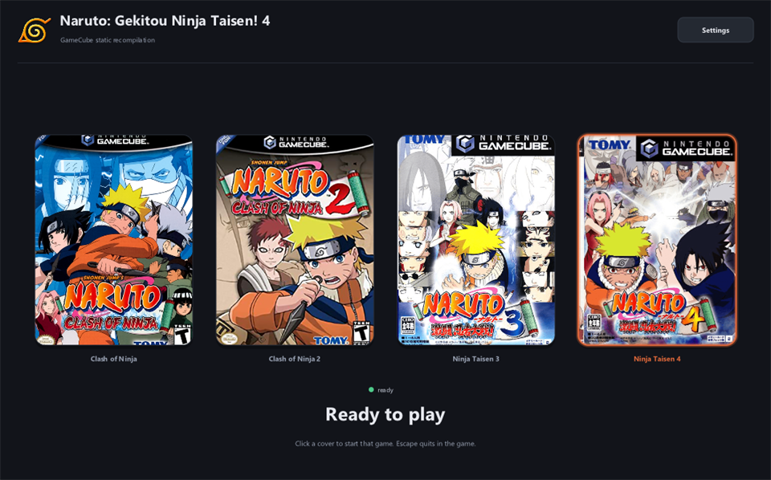

# Naruto: Clash of Ninja — static recompilation

Native Windows and macOS builds of four GameCube games, made from your own disc. The PowerPC
code is translated to C once and linked against a runtime that implements the GameCube's
hardware, so this is not an emulator: it is an ordinary executable that runs the real game, at
7× to 9.5× the console's 60 fps.

| Game | Disc ID |
| --- | --- |
| Naruto: Clash of Ninja | `GNREDA` |
| Naruto: Clash of Ninja 2 | `GNUEDA` |
| Gekitou Ninja Taisen! 3 | `G3NJDA` |
| Gekitou Ninja Taisen! 4 | `G4NJDA` |



*Box art is fetched on first run, never shipped.*

## Download and run

Releases are on the
[releases page](https://github.com/mapleleafjack/ClashOfNinja-recomp/releases/latest) (latest is
v1.3.0).

| Platform | Download | Also needs |
| --- | --- | --- |
| Windows 10/11 x64 | `NarutoLauncher-Windows-x64-v<version>.zip` (~4 MB) | nothing |
| macOS 14+, Apple Silicon | `NarutoLauncher-macOS-arm64-v<version>.zip` (~14 MB, sources and tools inside) | a C++ compiler: `xcode-select --install` (free) or Xcode |
| Linux | none — build from source, see [BUILDING.md](docs/BUILDING.md) | `cmake ninja-build g++ libsdl2-dev python3` |

1. **Unzip it.** On Windows use a path with no spaces in it, for example
   `C:\Games\NarutoLauncher` — MinGW-w64 will not run from one. Windows may also warn that the
   publisher is unknown, as the launcher is not code-signed yet: *More info → Run anyway*. On
   macOS, right-click → Open the app the first time (it is signed ad hoc, not notarised).
2. **Start the launcher.** The four games appear as covers.
3. **Click a cover and choose your disc image.** The first click extracts the disc and builds
   the game, which takes a few minutes; on Windows it first fetches about 190 MB of build
   tools, with a progress bar.
4. **Play.** After that a click starts the game. Saves and controller mappings stay in that
   game's folder.

The `NarutoLauncher-tools-windows-x64-v<version>.zip` asset is that same toolchain, for anyone
who would rather fetch it by hand than on the first build. You do not need it otherwise.

From a terminal instead of the launcher:

```sh
tools/setup.sh --run "/path/to/your disc image"   # add naruto2, gnt3 or gnt4 as a second argument
```

You need your own disc image either way, in any format nodtool reads: ISO, CISO, RVZ, WIA, GCZ,
WBFS, TGC or NFS. It is read once and can be deleted afterwards.

## Read more

| | |
| --- | --- |
| [Building and running](docs/BUILDING.md) | disc setup, a build from source, the command line |
| [The launcher](docs/LAUNCHER.md) | what it does, and how to build it |
| [Recompilation notes](docs/RECOMPILATION.md) | how far each game gets, how the disc reaches it, the steering tables, what each disc turned out to be |
| [Releases](docs/RELEASING.md) | CI, the Windows and macOS packages, and what may be published |

## Licensing

MIT © 2026 Jack Musajo; see [LICENSE](LICENSE). What it builds on — gcn-recomp, glad, SDL2, stb —
is listed in [THIRD-PARTY-NOTICES.md](THIRD-PARTY-NOTICES.md) and `licenses/`.

**No game data is included, in any form.** You need your own disc.

**Unofficial.** Not affiliated with, endorsed by or licensed by Nintendo, Shueisha, or the game's
developers and publishers.
