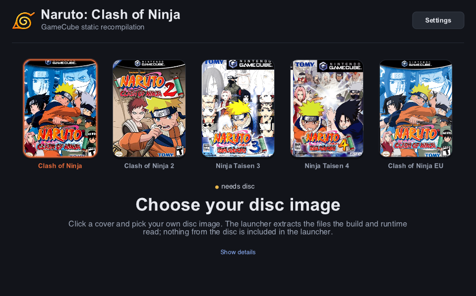

# Naruto: Clash of Ninja — static recompilation

<a href="https://ko-fi.com/jack2438"></a>

Native Windows and macOS builds of five GameCube games, made from your own disc. The PowerPC
code is translated to C once and linked against a runtime that implements the GameCube's
hardware, so this is not an emulator: it is an ordinary executable that runs the real game, at
6× to 9.5× the console's frame rate. The launcher also plays the community's mods — file
mods, Gecko codes and disc patches such as SCON4 — over that same disc.

| Game | Disc ID |
| --- | --- |
| Naruto: Clash of Ninja | `GNREDA` |
| Naruto: Clash of Ninja 2 | `GNUEDA` |
| Gekitou Ninja Taisen! 3 | `G3NJDA` |
| Gekitou Ninja Taisen! 4 | `G4NJDA` |
| Naruto: Clash of Ninja - European Version | `GNUPDA` |

**SCON4** — *Super Clash of Ninja 4*, the GNT4 overhaul at
[gnt4.online](https://gnt4.online) — is in the launcher's catalog. Check it in **Mods** and
press **Apply**: the newest release is fetched and read over your own GNT4 disc, so there is no
second image to keep. The executable it carries is not recompiled — the game runs this build's
code over SCON4's disc, at the frame rate above.

The game projects are not in this repository: each one's symbol map and steering tables come
from the disc, so the launcher writes the projects into its own folder and reads your own
disc for the symbol maps. A release carries no game folder — [Releases](docs/RELEASING.md)
covers what it does carry.



*Box art is fetched on first run, never shipped.*

## Download and run

Releases are on the
[releases page](https://github.com/mapleleafjack/ClashOfNinja-recomp/releases/latest) (latest is
v1.5.1).

| Platform | Download | Also needs |
| --- | --- | --- |
| Windows 10/11 x64 | `NarutoLauncher-Windows-x64-v<version>.zip` (~4 MB) | nothing |
| macOS 14+, Apple Silicon | `NarutoLauncher-macOS-arm64-v<version>.zip` (~13 MB, tools inside) | a C++ compiler: `xcode-select --install` (free) or Xcode |
| Linux x64 | `NarutoLauncher-Linux-x64-v<version>.tar.xz` (~2 MB, SDL2 inside) | `cmake ninja-build g++`, or Linuxbrew, which needs no root on SteamOS |

1. **Unzip it.** On Windows use a path with no spaces in it, for example
   `C:\Games\NarutoLauncher` — MinGW-w64 will not run from one. Windows may also warn that the
   publisher is unknown, as the launcher is not code-signed yet: *More info → Run anyway*. On
   macOS, right-click → Open the app the first time (it is signed ad hoc, not notarised).
2. **Start the launcher.** The games appear as covers.
3. **Click a cover and choose your disc image.** The first click writes that game's folder
   into the launcher's own folder, extracts the disc and builds the game, which takes a few
   minutes; on Windows it first fetches about 190 MB of build tools, with a progress bar and
   the output in Activity. A step that fails offers **Try again**, and **Use a different
   image** for a disc that is not the one meant.
4. **Play.** A cover only chooses the game: **Play** starts it, and **Stop the game** ends it.
   **Mods** and **Geckos** change what it plays — see [below](#mods-codes-and-patches). Saves
   and controller mappings stay in that game's folder.

**Settings**, in the top right, holds the three things the launcher cannot work out for
itself: **Players…** (which device plays as each of the console's four pads), the window scale
a game opens at, and the update check. The launcher asks GitHub for a newer release when it
starts, and *Update now* replaces it in place; the disc, the build and the saves stay where
they are.

The `NarutoLauncher-tools-windows-x64-v<version>.zip` asset is that same toolchain, for anyone
who would rather fetch it by hand than on the first build. You do not need it otherwise.

From a terminal instead of the launcher:

```sh
tools/setup.sh --run "/path/to/your disc image"   # second argument: naruto2, gnt3, gnt4, narutoeu
```

You need your own disc image either way, in any format nodtool reads: ISO, CISO, RVZ, WIA, GCZ,
WBFS, TGC or NFS. It is read once and can be deleted afterwards.

## Mods, codes and patches

**Mods** beside **Play** is the table for the selected game, holding only what that game's disc
can play: five discs are five address spaces, so a mod is offered for the discs it names and a
code never crosses between them.

- **A mod** is a folder in `mods/` that replaces files in the copy the launcher extracted —
  `disc/files/opening.bnr`, `disc/sys/main.dol` and the like — and can carry Gecko codes of
  its own. `mods.json`, shipped beside the launcher, lists mods before they are downloaded, so
  a row can be checked before it has any files; **Apply** is what fetches it and writes the
  choice.
- **Geckos** is one code at a time, kept per disc in `geckos/<DISCID>.txt`. The community's
  write-up for that disc is fetched on its own the first time the launcher runs for it, and a
  code this recompiler cannot run is named in Activity rather than quietly doing nothing.
- **A disc patch** is an xdelta of the whole disc, decoded as the game reads its files, so
  there is no second image and no second extraction — SCON4 above is one. **Choose a patch
  file…** adds one that no catalog names, and only a delta whose windows decode from your disc
  is kept.

Your disc and the extracted tree are not touched: a mod is a line in a manifest, and switching
one off deletes the line. A code that writes memory is applied each frame, so switching it
needs only a restart; one that patches instructions rebuilds the game once, in about 20
seconds. [Mods](docs/MODS.md) has the formats and the limits.

## Read more

| | |
| --- | --- |
| [Building and running](docs/BUILDING.md) | disc setup, a build from source, the command line |
| [The launcher](docs/LAUNCHER.md) | what it does, and how to build it |
| [Recompilation notes](docs/RECOMPILATION.md) | how far each game gets, how the disc reaches it, the steering tables, what each disc turned out to be |
| [Mods](docs/MODS.md) | what a mod is, and how the launcher and the runtime serve it over your own disc |
| [Releases](docs/RELEASING.md) | CI, the Windows and macOS packages, and what may be published |

## Licensing

MIT © 2026 Jack Musajo; see [LICENSE](LICENSE). What it builds on — gcn-recomp, glad, SDL2, stb —
is listed in [THIRD-PARTY-NOTICES.md](THIRD-PARTY-NOTICES.md) and `licenses/`.

**No game data is included, in any form.** You need your own disc.

**Unofficial.** Not affiliated with, endorsed by or licensed by Nintendo, Shueisha, or the game's
developers and publishers.
