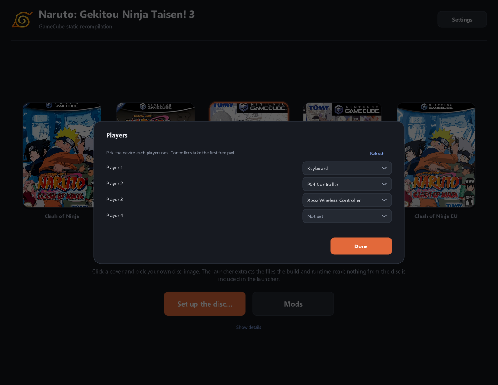

# The launcher

[README](../README.md) · [Building and running](BUILDING.md) · [Recompilation notes](RECOMPILATION.md) ·
[Mods](MODS.md) · [Releases](RELEASING.md)

`launcher/` is one C++ application that builds on Windows, macOS and Linux. Its window is the
games it finds, as box-art covers: a cover chooses the game, **Play** asks for your disc image
and builds as needed, then plays, and **Mods** is where what the game plays is changed. It
draws its own interface — no widget toolkit, one executable
per platform — and needs only SDL2, the same library the game's runtime uses. The layout is
drawn for a 1060×820 window and zooms with the window from there, so the text and buttons keep
their size against the covers on a large display instead of shrinking into a corner.



*Each of the console's four players takes a device, remembered in the game's `controls.txt`.*

## Building it

```sh
# macOS: xcode-select --install, then
brew install cmake ninja sdl2

# Debian/Ubuntu
sudo apt install cmake ninja-build g++ libsdl2-dev

# build and run
cmake -S launcher -B launcher/build -G Ninja -DCMAKE_BUILD_TYPE=Release
ninja -C launcher/build NarutoLauncher
launcher/build/NarutoLauncher              # macOS: launcher/build/NarutoLauncher.app
```

A plain configure is a development build, version 0.0.0, and it never offers to update itself
to a published release — that would replace the copy you are working on. A release build
passes its tag as `-DNLA_VERSION=<version>`.

On Windows, CMake finds the SDL2 that `gcn-recomp` already builds under
`%LOCALAPPDATA%\gcn-recomp`; pass `-DSDL2_DIR=<the folder holding SDL2Config.cmake>` to use
another. A release of the launcher is a single executable — SDL2 is linked in statically — so
nothing else has to be installed for it to start.

## What it does

- **Launch the game.** Clicking a cover makes that game the current one: it asks for the disc
  image when the game data is missing, builds the game when there is no binary yet, and
  otherwise starts it. While it works, the step and a progress bar replace the status line and
  Activity shows the output; while the game runs, a Stop button appears beside the covers.
- **Covers.** A game's cover is `covers/<game>.png` (`.jpg` and `.jpeg` work too), fitted into
  a 3:4 tile with rounded corners, so any size works. Box art belongs to the publisher, so it
  is **not shipped**: the launcher downloads it from
  [libretro-thumbnails](https://github.com/libretro-thumbnails/Nintendo_-_GameCube) into
  `covers/` the first time it needs it, and a file you put there wins over anything it fetched.
  A `cover.png` beside the game still works, so art an earlier copy was given keeps being
  used. Without one, the tile names the game and says where the file goes.
- **Games.** The outlined cover is the game the launcher works on: *Clash of Ninja*, *Clash of
  Ninja 2*, *Gekitou Ninja Taisen! 3*, *Gekitou Ninja Taisen! 4* or *Clash of Ninja European
  Version*. Each has its own disc, build and saves under its own folder, and the launcher
  remembers the last choice; the title and window name follow the highlighted cover. Every
  game is offered, even before its folder exists: choosing one writes the folders the project
  is missing, so a disc, a build and saves for it have somewhere to go.
- **Game disc.** Reads ISO and CISO itself, including the FST offset shift that NKit and
  rebuilt images use. Other formats (RVZ, WIA, GCZ, WBFS, TGC, NFS) are converted with
  `nodtool` first. It checks `main.dol`'s SHA-1 before writing anything and puts the new tree
  in place only when the whole extraction succeeded, waiting a few seconds for a file another
  program still has open — a virus scanner on a just-written file, say — instead of failing on
  it. The extractor writes the same bytes, and the same `disc.manifest`, as
  `tools/extract_disc.py`. The expected disc ID and `main.dol` hash are read from the selected
  game's `CMakeLists.txt`.
- **Build.** CMake and Ninja, with their output streamed into Activity, a progress bar and
  Cancel. Cancel ends the whole build tree — a job object on Windows, the process group
  elsewhere — so compilers the build started go too.
- **Play.** The same `--scale`, `--no-music`, `--no-input-log`, `--players` and `--controls`
  arguments as the command line. Stop sends `SIGINT` on macOS and Linux, which the runtime
  answers by dumping its GX FIFO, then escalates if the game ignores it.
- **Players.** The **Players…** button opens a row for each of the console's four pads, and a
  picker for the device that plays as it: *Not set*, the keyboard, or one of the controllers
  the game can see. A controller with no pad of its own takes the first pad that is free, and
  a pick pins every controller to the pad its row shows, so nothing is left to guess. *Refresh*
  looks again after a device comes or goes. The picks are written to the game's `controls.txt`
  as `pad = "<device>" <n>` and `keyboard_pad = <n>`, the file the runtime reads, so the same
  choice can be made by hand or passed to someone else; a comment or a binding already in that
  file is kept. The launcher asks the game itself for the device list (`--list-devices`), so
  the names are the ones the runtime matches. Changing a pad takes effect the next time the
  game is started.
- **Mods.** A folder in `mods/` holds a `mod.txt`, a `disc/` tree of the files it puts in
  place of the disc's, and optionally `gecko.txt` with the Gecko codes it switches on.
  **Mods** on the game's page opens the table for that game, and only what its disc can
  play is in it: those folders, the disc patches in `patches/` that the catalog names for
  it, and the known mods in `mods.json` that have not been downloaded. Checking a row stages
  it and **Apply** writes the choice — downloading a
  known mod or patch first when its files are not on the machine — so a row can be picked
  before it exists locally. Unchecking a row and applying removes it. Closing without
  Apply leaves the game as it was. Files and codes that write memory need no rebuild: the
  launcher writes the lists beside `disc.manifest` and the runtime serves those reads and
  runs those codes, so switching a mod off is deleting the lists. A code that patches
  *instructions* is compiled in, so enabling it says **Ready to rebuild** and the build
  runs before the game starts — only the patched functions, in about 20 seconds. A build's
  addresses are its own, so a mod is only ever offered for the discs it names.
  [Mods](MODS.md) has the format, the catalog and the limits.
- **Disc patches.** A patch row takes an xdelta of the whole disc — SCON4, a translation,
  a rebalancing hack. The catalog's patches are downloaded when they are checked and
  applied, or **Choose a patch file…** adds one already on the machine. Either way the
  launcher decodes a sample of the delta's windows against the extracted disc and only
  keeps one that agrees with it, then leaves `patch.manifest` beside `disc.manifest` naming
  the delta and what the space between files reads as there. The runtime decodes the patch
  as the game asks for its files, so there is no second image and no second extraction;
  unchecking the row and applying removes the manifest again. The game still runs this
  build's code: a patch that ships its own executable is played, not recompiled.
- **Updates.** The launcher asks GitHub for the newest release when it starts, and offers it
  when that release is newer than the one it was built from. *Update now* downloads the zip for
  this system, unpacks it and hands over to a small helper: the launcher exits, the helper puts
  the new version in place of the old one and starts it. Until then nothing is touched.
  Settings names the version, has *Check now* and can turn the check off; a version answered
  with *Cancel* is not asked about again but stays behind the **Update** button in the header.
  A build from a branch hides itself from this, and an install that cannot be written to falls
  back to the release page. The check is the only network request the launcher makes, apart
  from box art and the dtk it fetches when it has none.
- **Game source.** A package carries no game folder: the launcher writes `naruto\`,
  `naruto2\`, `gnt3\`, `gnt4\` and `narutoeu\` into the folder it lives in, with the
  recompiler and `tools\extract_disc.py` beside them, when a game is first chosen — a project
  from an earlier launcher gets the games it is missing the same way, since nothing already
  in a game folder is overwritten — and dtk makes that disc's symbol map. A release carries
  dtk in `tools\dtk`; a `-Lean` release, or a copy the tool archive was never downloaded for,
  fetches the pinned build (about 8 MB) into `tools\dtk` the first time a symbol map is
  needed, so nothing has to be installed by hand.
  An update replaces the launcher only; the disc, the build and the saves stay where they are.
- **Settings.** Three things, and nothing else: **Players…** (which device plays as each of the
  four players), the window scale a game opens at, and the update check. Everything else the
  launcher works out on its own — the folder is always the one the executable is in, and the
  disc image is asked for from the main page — and the remaining play options keep their
  defaults: music on, input log on.
- **Choosing a folder or an image.** The platform's own chooser: `IFileOpenDialog` with
  `FOS_PICKFOLDERS` on Windows, `NSOpenPanel` on macOS, `zenity` or `kdialog` on Linux. Only a
  Linux machine with neither of those falls back to the picker the launcher draws itself.
- **Tools.** A `tools/` folder beside the executable comes first (inside a macOS bundle it is
  `Contents/Resources/tools`), then `PATH`, then the platform's usual install locations (winget
  packages and Program Files on Windows, Homebrew on macOS, `/usr/local` and `~/.cargo/bin`
  everywhere). On Windows, when the build tools are nowhere to be found, the launcher offers
  to fetch them itself: it downloads the archive pinned when it was built, checks it against
  the pinned SHA-256, and unpacks it into `tools/` — the prompt that appears when a build is
  asked for without them.

Drag a disc image or a project folder onto the window, or click a cover. A package carries no
game project, so the covers are always shown and the first game chosen sets its folder up
beside the launcher — the game folders, the disc, the build and the saves are always
in the launcher's own folder, never one above it or one used earlier. *Show details* reveals
the Activity log whenever it is hidden; the covers stay, smaller, beside it. Cover art added
while the launcher is running is picked up the next time it starts.

## Testing it without a window

```sh
ctest --test-dir launcher/build
```

The tests render the main window, Settings, the Players panel, the picker and the update prompt
to BMP files through

```
--render <file> [main|settings|players|picker|confirm|update|update-banner
                 |click:x,y|settings-click:x,y|players-click:x,y|update-click:x,y
                 |cover-click:<index>] [WxH]
```

which needs no window and no desktop. The click modes paint, click that point and paint again
(the `settings-`, `players-` and `update-` forms open those views first), so the tests cover hit
testing and activation as well as drawing. Points separated by `;` click in turn, so a test can
open a menu and then pick from it; a render leaves `controls.txt` alone, and it does not fetch
box art. A size such as `2560x1417` renders the view as a window of that size would draw it,
zoom and all. A render needs one usable system font; on a minimal Linux install that means
`fonts-dejavu` or `fonts-liberation`. The screenshots in this documentation are renders.

`cover-click:<index>` clicks a game's cover in a project folder of its own beside the render,
which holds only the first game — so the page has to leave that game for the one clicked, and a
game whose folder the launcher has not written yet must still be the game it lands on. The exit
code is the check: the test fails when the page stays on another game.

`launcher/tests/extract_test.cpp` runs the extractor from a console so its output can be
compared with `tools/extract_disc.py`; it is a developer target, not shipped.
`launcher/tests/project_test.cpp` covers choosing a game without a disc: a game the launcher
knows but has not set up yet is still the game asked for, and writing the game folders leaves
what a player already has alone and gives each game its own disc back.
`launcher/tests/update_test.cpp` covers the update check without a network: version comparison,
reading a release out of GitHub's JSON, and the helper script, which the test runs for real
against a stand-in install. It also builds a throwaway git repository to check that an
out-of-date clone fast-forwards and a modified one is refused. `update_test --live` also asks
GitHub once and prints the release it finds.

`--fetch-tools <log>` runs the same download the launcher offers, without a window, and writes
what its steps report to `log`. A release build uses it to prove the pinned archive still
downloads and still matches its digest.
